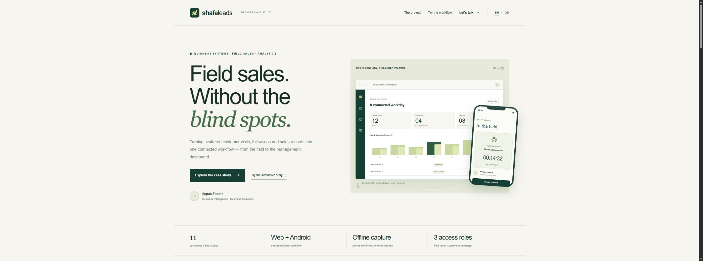
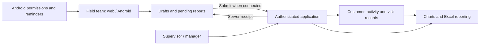

# Shafa Leads — Field Sales CRM Case Study

A project by **Sepas Zohari** connecting field activity, follow-up and management reporting in one operational workflow.

[Explore the case study](https://shafa.185-211-59-57.backname.io/portfolio/) · [Deutsch](https://shafa.185-211-59-57.backname.io/portfolio/?lang=de) · [German README](README-DE.md)

[Direct HTTPS mirror](https://185.211.59.57/portfolio/) · [German mirror](https://185.211.59.57/portfolio/?lang=de)

## The business problem

A customer visit produces more than a report: it creates a next action, information to review and a record that other people need to trust. Shafa Leads brings customer records, daily plans, visits, phone calls and follow-ups into a shared field-sales process. The product interface is Persian and right-to-left, with web and Android workflows.

This repository contains the public English/German case study and its interactive explainer. The page uses fictional records and illustrative interfaces. The operational CRM is a separate application.

## My contribution

My focus was translating the team's work into a connected process and data model, then carrying those decisions through AI-assisted implementation and validation:

- An eleven-stage workflow connecting the first customer record, assessment, product demonstrations, negotiation, collection follow-up and repeat business.
- Clear ownership, role-scoped views and traceable customer changes.
- Distinguishing work captured on a device from reports confirmed by a server receipt.
- Separating elapsed visit time from estimated presence and preserving uncertainty when location evidence is missing or unreliable.
- Connecting operational activity to charts and multi-sheet Excel exports that managers can inspect.

AI supported development. Process decisions, behavior checks and an understanding of the system's limits remained part of the work. This case study describes implemented behavior and documented validation; it does not claim measured revenue gains, universal device support or a formal security certification.

## Selected product behavior

| Area | Behavior |
| --- | --- |
| Interrupted reporting | Account-scoped drafts and pending reports, server receipts and duplicate protection support recovery and retries. |
| Visit evidence | Location samples support estimated presence; missing or unreliable intervals remain unknown and can require review. |
| Follow-up | Native Android reminders support tasks after the app closes when the required permissions are enabled. |
| Access and reporting | Field staff, supervisors and managers have role-scoped access; activity filters, charts and Excel exports support review. |
| Sales process | Eleven stages retain customer context from identification through repeat business or closure. |

Document sharing, quotations and collection follow-up are represented as workflow stages, notes and next actions. They are not standalone document-management, invoicing or payment-processing modules. Real-device checks apply to the devices and versions tested.

## Product architecture at a glance

This is a high-level view of the operational product. The public page below simulates only a small reporting scenario.

The operational stack includes Next.js, TypeScript, SQLite, Android/Java, ExcelJS and Linux/Caddy. The portfolio page itself is a standalone HTML file with embedded CSS and JavaScript.

## Try the interactive explainer

1. Open the case study and scroll to **Experience the logic**.
2. Switch the simulated connection off and record the outcome.
3. Observe **Pending**, then reconnect to see a simulated **Confirmed** receipt.
4. Repeat the action to see how the same report remains a single record.
5. Reset the scenario or switch between English and German.

The explainer keeps its state in browser memory. It makes no CRM requests, stores no reports, requests no location permission and simulates the server response. Refreshing or resetting clears the scenario. It demonstrates the difference between pending and confirmed work; it is not an authenticated product demo or a browser-offline test of the CRM.

## Run locally

Open `index.html` in a browser. No dependency installation or build step is required. English is the default; use the **DE** control for German. The published German page also opens directly with `?lang=de`.

## Contact

[LinkedIn](https://www.linkedin.com/in/sepaszohari/) · [GitHub](https://github.com/SZohari) · [Email](mailto:sepas.zohari2002@gmail.com)
